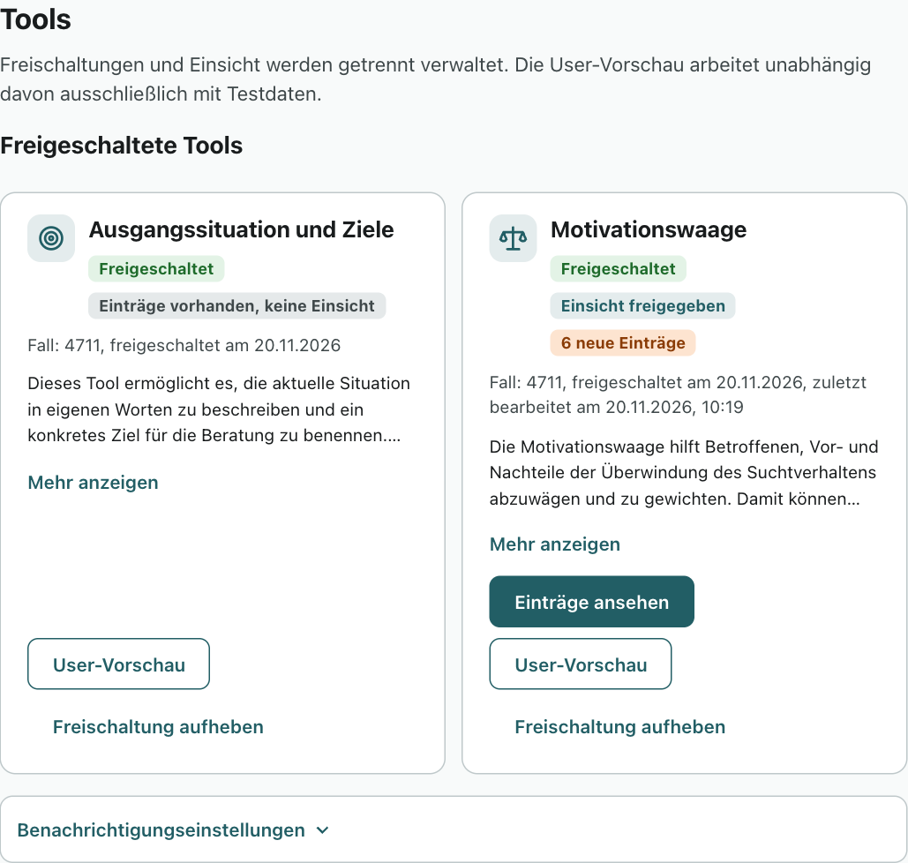
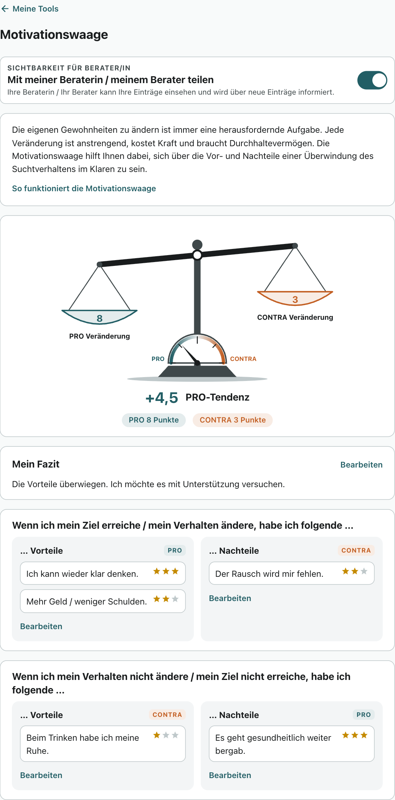
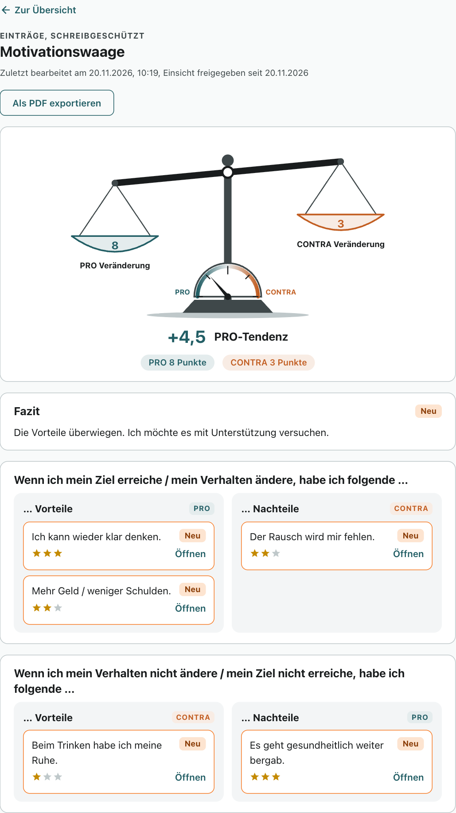

# Beratungstools

Digitale Übungen für die Suchtberatung in einem Add-on. Die Beraterin oder der Berater schaltet einer ratsuchenden Person einzelne Tools frei; die Person bearbeitet sie in ihrem eigenen Tempo und entscheidet selbst, ob die Beratung ihre Einträge sehen darf. So entstehen Ansatzpunkte für das nächste Gespräch, ohne dass etwas ungefragt geteilt wird.

## Tools

Verfügbar sind bisher:

- **Ausgangssituation und Ziele:** Vier Fragen zur aktuellen Situation (Situation, was eine Veränderung schwierig macht, Gründe für eine Veränderung, persönliche Ressourcen), danach ein persönliches Ziel und eine Zusammenfassung, in der sich jede Angabe wieder bearbeiten lässt. Die Eingaben werden automatisch gespeichert.
- **Motivationswaage:** Vor- und Nachteile einer Veränderung des Suchtverhaltens in vier Listen, jeweils von „gar nicht wichtig“ bis „sehr wichtig“ bewertet. Die Waage rechnet die gewichteten PRO- und CONTRA-Punkte auf eine Skala von −10 bis +10 um und zeigt so das Verhältnis, nicht die Zahl der Argumente. Dazu ein persönliches Fazit und Beispieltexte für den Einstieg.

- **Ampelmodell:** Medienaktivitäten (zum Beispiel „Ein Computerspiel spielen“ oder „Instagram“) werden nach ihrer persönlichen Suchtgefahr in eine Ampel eingeordnet: Rot für große Gefahr, Gelb für mögliche Gefahr, Grün für keine Gefahr. Ein Klick auf eine Aktivität öffnet sie zum Ändern oder Löschen. Jedes Feld nennt seine Farbe und Gefahrenstufe auch als Text, eine Legende erklärt die Stufen. Die Beratung sieht dieselbe Ampel schreibgeschützt.
- **Positives Wahrnehmen:** Für Eltern. Vier Seiten: eine Einführung zu negativer Aufmerksamkeit in der Familie, ein Schema, in dem ein Klick auf eine Bemerkung der Eltern zeigt, was sie im Kind auslösen kann (Selbstbild, Gefühl, mögliches Verhalten), eine kurze Erläuterung und zuletzt eine Liste von Verhaltensweisen des Kindes, die die Eltern loben möchten, mit Beispielen und einem Hinweis zum Loben. Die Tool-Beschreibung sieht keine Ansicht für die Beratung vor; wenn die Eltern teilen, sieht die Beratung die gespeicherten Verhaltensweisen als einfache Liste.

In Vorbereitung sind Konsumtagebuch, Tagebuch für Angehörige, Notfallkoffer, Aktiv sein und Risikosituationen und Kontrollstrategien. Sie erscheinen erst, wenn sie fertig sind.

## Ablauf

1. **Freischalten:** Im Fall öffnet die Beratung „Tools“. Die Kacheln stehen in zwei Gruppen, „Freigeschaltete Tools“ und „Noch nicht freigeschaltete Tools“, jeweils mit einer kurzen Beschreibung. „Freischalten“ gibt ein Tool frei, die ratsuchende Person wird benachrichtigt und findet es unter „Meine Tools“ in der Navigation und im Menü des Chats. Eine Freischaltung lässt sich aufheben; die Einträge bleiben dann gespeichert und sind nach einer neuen Freischaltung wieder da.
2. **Bearbeiten:** Die ratsuchende Person arbeitet im Tool, in der für sie eingestellten Anrede (Sie oder du). Eine Anzeige bestätigt, dass gespeichert wurde.
3. **Teilen:** Jedes Tool hat den Schalter „Mit meiner Beraterin / meinem Berater teilen“, anfangs aus. Erst wenn er an ist, sieht die Beratung die Inhalte; die Person kann ihn jederzeit wieder ausschalten.
4. **Einsehen:** „Einträge ansehen“ öffnet die geteilten Inhalte schreibgeschützt. Was die Beraterin oder der Berater noch nicht gesehen hat, ist als „Neu“ markiert, und die Kachel zeigt, wie viele neue Einträge es gibt. Die Inhalte lassen sich als PDF exportieren (Tool, Fall, Exportdatum, Zeitraum der Einträge und Inhalt).
5. **User-Vorschau:** Beratende können jedes Tool mit eigenen Testdaten ausprobieren, auch ohne Freischaltung. Die Vorschau ist deutlich gekennzeichnet, berührt keinen Fall und lässt sich mit „Demo zurücksetzen“ in den Ausgangszustand bringen.

## Benachrichtigungen

Die Beratung wird über die Benachrichtigungen von ORISO informiert, wenn eine ratsuchende Person ein Tool zur Einsicht freigibt, neue Einträge anlegt oder Einträge ändert. Mehrere Änderungen innerhalb von 15 Minuten werden zu einer Benachrichtigung zusammengefasst. Benachrichtigungen nennen den Benutzernamen, das Tool und die Art der Änderung, nie Inhalte. Jede Beraterin und jeder Berater legt in der Tool-Übersicht unter „Benachrichtigungseinstellungen“ fest, über welche der drei Ereignisse sie oder er informiert werden möchte. Ob zusätzlich eine E-Mail verschickt wird, richtet sich nach den eigenen Einstellungen in ORISO.

## Datenschutz

- Freischaltung, Einträge und Einsicht sind getrennt: Eine Freischaltung allein erlaubt keine Einsicht. Ohne Teilen sieht die Beratung nur, ob ein Tool freigeschaltet ist und ob es Einträge gibt, keine Inhalte.
- Jeder Zugriff auf Inhalte und jeder Export wird unmittelbar vorher auf dem Server geprüft. Wird die Einsicht zurückgenommen, sind die Inhalte sofort nicht mehr erreichbar, auch nicht über ältere Benachrichtigungen.
- Die Inhalte liegen nur beim Add-on, nicht im Chat und nicht in den ORISO-Diensten.
- Freischaltungen, Aufhebungen, Exporte und das Teilen werden im Protokoll von ORISO-Admin vermerkt.
- Wird ein Konto gelöscht, löscht das Add-on alle zugehörigen Daten mit.
- Neue Freischaltungen sind nur möglich, wenn der Träger die aktuelle Auftragsverarbeitungsvereinbarung bestätigt hat. Bereits freigeschaltete Tools bleiben nutzbar.

## Einstellungen

Je Träger und je Beratungsstelle:

- **Teilen erlauben:** Ausgeschaltet bleiben alle Einträge nur für die ratsuchende Person sichtbar.
- **Je Tool ein Schalter, ob es angeboten wird.** Ein ausgeschaltetes Tool kann nicht freigeschaltet werden und ist für niemanden sichtbar.
- **Ausgangssituation und Ziele:** eigener Einleitungstext.
- **Motivationswaage:** eigener Einleitungstext und die Beschriftung der Waage: „CONTRA / PRO Veränderung“, „keine Veränderung / Ich möchte etwas ändern!“ oder „gut so, wie es ist / es muss sich was ändern!“.
- **Ampelmodell:** eigener Einleitungstext.
- **Positives Wahrnehmen:** eigener Einführungstext für die erste Seite.

## Statistik

Je Tool die Zahl der Freischaltungen, der begonnenen und der geteilten Tools, ohne Bezug zu Personen. Testdaten aus der User-Vorschau werden nicht gezählt.
